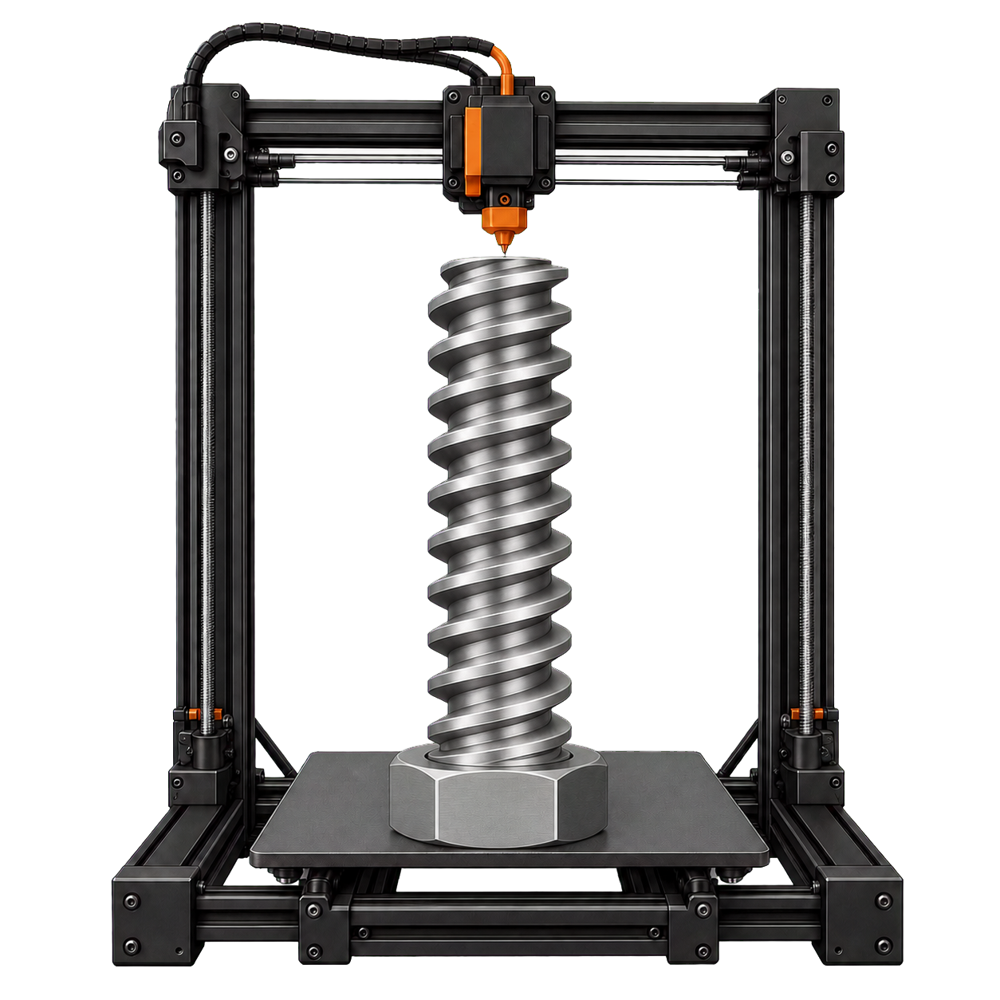
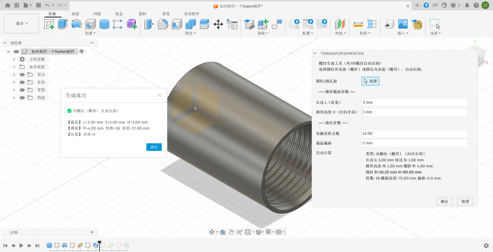
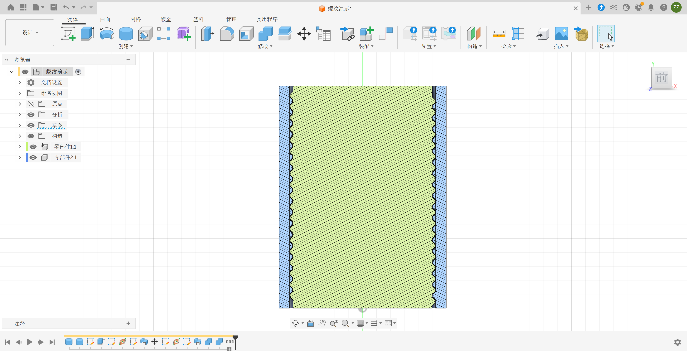

# Fusion 360 3D Printable Thread Generator

[](https://github.com/HookyMaster/ThreadFor3DPrinter/releases/latest)
[](LICENSE)


[中文说明](README.zh-CN.md) · [Download the latest release](https://github.com/HookyMaster/ThreadFor3DPrinter/releases/latest/download/ThreadFor3DPrinter-v3.0.0.zip)



**ThreadFor3DPrinter** is an Autodesk Fusion add-in that generates coarse trapezoidal **internal and external threads for 3D printing**. Select a cylindrical face and the add-in automatically detects whether it belongs to a bolt or a nut/hole.

## Features

- Generates both external bolt threads and internal nut/hole threads.
- Uses a 3D-printing-friendly trapezoidal profile with an adjustable **5°–45° flank angle**.
- Automatically detects internal and external cylindrical faces.
- Provides adjustable tooth-root width, tooth height, flank angle, sampling resolution, and end offset.
- Automatically calculates the tooth crest width and preserves a minimum `0.2 mm` crest flat to prevent profile self-intersection.
- Optional **thread lead-in/lead-out**: the first and last 1/8 turn of the thread ramp the section (tooth height + width) from 10% to full size, so mating parts slide in easily and both ends stay print-friendly; can be disabled in the dialog.
- Shows the estimated helix length and spline-point count, with warnings for risky sampling settings.
- Reports a suggested mating nut or bolt diameter after generation, including recommended print clearance.
- Supports Autodesk Fusion on Windows and macOS.

## Screenshots

| External thread | Internal thread | Screw-top jar example |
| --- | --- | --- |
|  |  |  |

### Internal and external thread section view



## Files required for installation

Keep these three files together in one folder:

```text
ThreadFor3DPrinter/
├── ThreadFor3DPrinter.py
├── ThreadFor3DPrinter.manifest
└── icon-v4.png
```

The manifest uses `icon-v4.png` as the icon shown in Fusion's **Scripts and Add-Ins** dialog.

## Installation

### Windows

Copy the complete `ThreadFor3DPrinter` folder to:

```text
%APPDATA%\Autodesk\Autodesk Fusion 360\API\AddIns\
```

### macOS

Copy the complete `ThreadFor3DPrinter` folder to:

```text
~/Library/Application Support/Autodesk/Autodesk Fusion 360/API/AddIns/
```

Alternatively, open **Utilities > Add-Ins > Scripts and Add-Ins**, select the **Add-Ins** tab, click the green **+** button, and select the `ThreadFor3DPrinter` folder.

## Starting the add-in

1. Open Fusion and switch to the **Design** workspace.
2. Open **Utilities > Add-Ins > Scripts and Add-Ins**.
3. Select the **Add-Ins** tab.
4. Select **ThreadFor3DPrinter** and click **Run**.
5. The **ThreadFor3DPrinter** command appears in the **Solid > Create** panel.

Enable **Run on Startup** in the Add-Ins dialog if you want it loaded automatically whenever Fusion starts.

## Preparing the model

- For an external thread, create a solid cylinder and select its outside cylindrical face.
- For an internal thread, create a cylindrical hole and select its inside cylindrical face.
- The target must be a true cylindrical BRep face. Conical, mesh, faceted, or arbitrary curved faces are not supported.
- Leave enough axial length for the selected thread dimensions and end offset.

## Operation

1. Run **ThreadFor3DPrinter** from **Solid > Create**.
2. Click **Cylindrical / hole face**, then select exactly one cylindrical face.
3. Confirm the detected type in the calculation area:
   - **External thread (bolt):** the profile grows outward.
   - **Internal thread (nut):** the profile grows inward.
4. Set the thread parameters:
   - **Long edge L (tooth-root width):** axial width at the root of the trapezoidal tooth profile. Default: `3 mm`.
   - **Trapezoid height H (tooth height):** radial height/depth of the thread tooth. Default: `1 mm`.
   - **Flank angle α:** angle between either tooth flank and the thread axis. Adjustable from `5°` to `45°`.
   - **Points per turn:** helix sampling resolution. Default: `16`; minimum: `4`. The add-in automatically raises this value for large diameters so the helix path stays within a quarter of the tooth height of the cylinder surface; the value you enter is used as a lower bound.
   - **End offset:** distance between the cylinder end and the start of the helix. Default: `0 mm`.
   - **Thread lead-in/lead-out:** when ticked (default), the first and last 1/8 turn of the thread ramp the section (tooth height + width) from 10% to full size, making it easier to start the mating part and keeping both ends print-friendly; untick to generate a full-height legacy thread.
   - **Join to cylinder:** when ticked (default), the thread body is boolean-joined with the selected cylinder into a single body; untick to keep the thread and cylinder as two separate bodies. Joining removes the seam visible between two bodies when zoomed in.
   - **Show advanced options:** tick to reveal the "Deviation ratio" input.
   - **Deviation ratio** (advanced): controls the allowed deviation of the fitted helix spline from the cylinder surface, expressed as a fraction of the tooth height H (allowed deviation = ratio × H). Default: `0.25` (deviation within a quarter of the tooth height); recommended range `0.1–0.5`. A smaller ratio uses more samples per turn for smoother tooth flanks but is slower to generate; too large a value may cause a sweep failure. Hover the mouse over the input for a detailed description.
5. Review the automatically calculated **tooth crest width S (crest flat)**, pitch, turn count, helix height and length, spline-point count, cylinder size, and detected thread type. The profile-status area directly below the H and angle inputs reports any automatic correction.
6. Click **OK** to generate the helical path, trapezoidal profile, and swept thread body.

## Parameter rules

The add-in calculates:

```text
Axial inset per flank A = H / tan(α)
Tooth crest width S     = L - 2A
Pitch P                 = L + S = 2(L - A)
Maximum H               = (L - 0.2 mm) × tan(α) / 2
```

`L` is the tooth-root width, `S` is the tooth crest width (crest flat), `H` is the radial tooth height, and `A` is the axial inset of each flank. Changing `H` or `α` recalculates `S` and the pitch. To keep a valid trapezoidal profile, `S` must remain at least `0.2 mm`. If the requested height would make it smaller, the add-in automatically reduces `H` to the maximum valid value while preserving the selected flank angle. This is a geometry safeguard, not a calculation error.

Inputs must satisfy:

- `L > 0.2 mm`
- `H > 0`
- `5° ≤ α ≤ 45°`
- `S = L - 2H / tan(α) ≥ 0.2 mm`
- For an internal thread, `H` must be smaller than the hole radius.

The add-in reserves approximately one full turn of axial space. The generated number of turns may therefore be lower than the simple cylinder-length/pitch ratio.

## After generation

The sweep is created as a **new body**. Use Fusion's **Combine** command to:

- **Join** it to the cylinder for an external thread.
- **Join** it to the surrounding part for an internal thread as well.

After generation, the completion dialog also shows a suggested mating diameter. Treat it as a starting point and validate the recommended `0.3–0.5 mm` clearance with a short print test.

For reliable 3D-printed mating parts, add clearance appropriate to your printer, material, layer height, and nozzle size. Test with a short sample before printing the final part.

## Headless automation API

`ThreadFor3DPrinter.py` also exposes two public Python functions for automation.
They generate threads directly without opening or controlling the Fusion command
dialog.

### Direct face call

```python
import ThreadFor3DPrinter as thread_tool

result = thread_tool.generate_thread(
    face=target_cylindrical_face,
    tooth_width_mm=1.5,
    tooth_height_mm=0.5,
    end_offset_mm=1.0,
    samples_per_turn=16,
    join_to_target=True,
    feature_name='Lid_Internal_Thread',
    max_turns_per_sweep=4,
    flank_angle_degrees=30,
    deviation_ratio=0.25,
    enable_lead=True,
)
print(result)
```

### JSON and entity-token call

```python
payload = {
    'face_token': target_cylindrical_face.entityToken,
    'tooth_width_mm': 1.5,
    'tooth_height_mm': 0.5,
    'end_offset_mm': 1.0,
    'samples_per_turn': 16,
    'join_to_target': True,
    'feature_name': 'Lid_Internal_Thread',
    'max_turns_per_sweep': 4,
    'flank_angle_degrees': 30,
    'deviation_ratio': 0.25,
    'enable_lead': True,
}

result = thread_tool.generate_thread_from_json(payload)
```

`generate_thread_from_json` accepts either a Python dictionary or a JSON object
string. Its result is a JSON-serializable dictionary containing:

- detected thread type (`external` or `internal`);
- tooth-root width, tooth crest width, tooth height, flank angle, and calculated pitch;
- turn count and generated thread length;
- cylinder radius and height;
- sampling and end-offset values;
- sweep segment count and maximum turns per segment;
- whether the generated thread was joined to the target body;
- the generated Fusion timeline group name;
- the resulting body entity token.

### Automation notes

- `face` must be a true cylindrical BRep face.
- Public API dimensions are expressed in millimetres.
- `flank_angle_degrees` must be between `5` and `45` and defaults to `45`.
- The calculated tooth crest width `tooth_width_mm - 2 * tooth_height_mm / tan(flank_angle_degrees)` must be at least `0.2 mm`.
- `samples_per_turn` has a minimum effective value of `4`. It is used as a
  lower bound: for large cylinder radii the add-in automatically raises it so
  the fitted helix stays within a quarter of the tooth height of the cylinder
  surface, which keeps the sweep on the guide face and avoids `ASM_SWEEP_ILLEGAL_SURFACE`. The
  effective value is clamped to a maximum of `360` per turn. If the adaptive
  per-turn density would push the total sample count beyond `20000`, the turn
  count is reduced instead of the sampling density, so every retained turn
  keeps full precision.
- `max_turns_per_sweep` defaults to `4`. Long threads are swept in multiple
  sections to avoid Fusion kernel failures. The linked pitch formula remains
  unchanged.
- `deviation_ratio` defaults to `0.25` (i.e. `HELIX_DEVIATION_TOLERANCE_RATIO`)
  and must be in `(0, 1]`. It is the maximum allowed deviation of the fitted
  helix spline from the cylinder surface as a fraction of the tooth height H
  (allowed deviation = `deviation_ratio * tooth_height_mm`). Lower values use
  more samples per turn for smoother tooth flanks but generate more slowly;
  values that are too large may cause `ASM_SWEEP_ILLEGAL_SURFACE`. Recommended
  range: `0.1–0.5`. The returned dict reports the effective value in the
  `deviation_ratio` field.
- `enable_lead` defaults to `True`: the first and last 1/8 turn of the thread
  ramp the section (tooth height + width) from 10% to full size, making it
  easier to start the mating part and keeping both ends print-friendly.
  Set it to `False` to generate a full-height legacy thread.
- One generation call creates one helix sketch, one profile plane, and one
  profile sketch. Later sweep sections draw their own trapezoid at each path
  start while retaining the cylindrical guide surface; adjacent segments
  overlap slightly at the seam so the boolean join is robust.
- All features created by one successful generation call are collected in one
  Fusion timeline group named `<feature_name>_Generation` when Fusion allows
  grouping. If grouping is not possible (for example, the affected timeline
  range already contains a group), generation still succeeds and the group is
  simply skipped.
- `join_to_target=False` preserves the GUI's legacy behaviour and returns a
  separate thread body.
- `join_to_target=True` joins the generated thread to the selected body and
  produces a single printable body.
- `feature_name` is used as the prefix for generated sketches, planes, sweep,
  body, and combine feature names.

## Troubleshooting

- **The OK button is disabled:** select exactly one cylindrical face and verify the parameter rules above.
- **Internal thread depth warning:** reduce `H` so it is smaller than the hole radius.
- **H was reduced automatically:** the requested H and flank angle would make the tooth crest width smaller than `0.2 mm`; the add-in uses the largest safe H to prevent a self-intersecting profile.
- **The command is missing:** run the add-in again from **Scripts and Add-Ins**, or restart Fusion.
- **The icon does not update:** close and reopen the **Scripts and Add-Ins** dialog, or restart Fusion.
- **The thread looks faceted:** increase **Points per turn**. Higher values produce more geometry and may take longer; the total helix sample count is capped at 20000, and beyond that the turn count is reduced rather than the sampling density.
- **Fewer turns than expected on a long, large-diameter thread:** the adaptive per-turn sampling reached the 20000-point budget, so the turn count was reduced to keep the path hugging the cylinder. Lower **Points per turn** slightly, or give the thread more usable length.
- **Sweep failure (ASM_SWEEP_ILLEGAL_SURFACE):** this usually means the helix path cannot stay close enough to the cylinder. The add-in adapts sampling to the radius automatically; if it still happens, lower **Points per turn** slightly or shorten the thread (smaller height or larger end offset).

## Uninstalling

Stop the add-in in **Scripts and Add-Ins**, close Fusion, and remove the `ThreadFor3DPrinter` folder from the AddIns directory.
