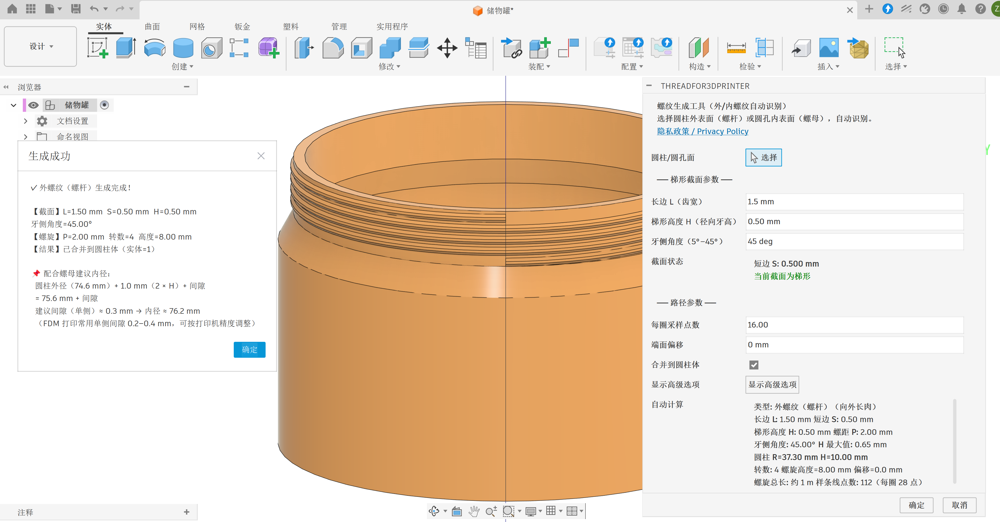

# Fusion 360 3D Printable Thread Generator

[](https://github.com/HookyMaster/ThreadFor3DPrinter/releases/latest)
[](LICENSE)


[中文说明](README.zh-CN.md) · [Download the latest release](https://github.com/HookyMaster/ThreadFor3DPrinter/releases/latest/download/ThreadFor3DPrinter-v1.1.1.zip)


**ThreadFor3DPrinter** is an Autodesk Fusion add-in that generates coarse trapezoidal **internal and external threads for 3D printing**. Select a cylindrical face and the add-in automatically detects whether it belongs to a bolt or a nut/hole.

## Features

- Generates both external bolt threads and internal nut/hole threads.
- Uses a 3D-printing-friendly trapezoidal profile with fixed **45-degree flanks**.
- Automatically detects internal and external cylindrical faces.
- Provides adjustable tooth width, thread height, sampling resolution, and end offset.
- Shows the estimated helix length and spline-point count, with warnings for risky sampling settings.
- Reports a suggested mating nut or bolt diameter after generation, including recommended print clearance.
- Supports Autodesk Fusion on Windows and macOS.

## Screenshots

| External thread | Internal thread |
| --- | --- |
|  |  |

### Internal and external thread section view


## Files required for installation

Keep these three files together in one folder:

```text
ThreadFor3DPrinter/
├── ThreadFor3DPrinter.py
├── ThreadFor3DPrinter.manifest
└── icon-v4.png
```

The manifest uses `icon-v4.png` as the icon shown in Fusion's **Scripts and Add-Ins** dialog.

## Installation

### Windows

Copy the complete `ThreadFor3DPrinter` folder to:

```text
%APPDATA%\Autodesk\Autodesk Fusion 360\API\AddIns\
```

### macOS

Copy the complete `ThreadFor3DPrinter` folder to:

```text
~/Library/Application Support/Autodesk/Autodesk Fusion 360/API/AddIns/
```

Alternatively, open **Utilities > Add-Ins > Scripts and Add-Ins**, select the **Add-Ins** tab, click the green **+** button, and select the `ThreadFor3DPrinter` folder.

## Starting the add-in

1. Open Fusion and switch to the **Design** workspace.
2. Open **Utilities > Add-Ins > Scripts and Add-Ins**.
3. Select the **Add-Ins** tab.
4. Select **ThreadFor3DPrinter** and click **Run**.
5. The **ThreadFor3DPrinter** command appears in the **Solid > Create** panel.

Enable **Run on Startup** in the Add-Ins dialog if you want it loaded automatically whenever Fusion starts.

## Preparing the model

- For an external thread, create a solid cylinder and select its outside cylindrical face.
- For an internal thread, create a cylindrical hole and select its inside cylindrical face.
- The target must be a true cylindrical BRep face. Conical, mesh, faceted, or arbitrary curved faces are not supported.
- Leave enough axial length for the selected thread dimensions and end offset.

## Operation

1. Run **ThreadFor3DPrinter** from **Solid > Create**.
2. Click **Cylindrical / hole face**, then select exactly one cylindrical face.
3. Confirm the detected type in the calculation area:
   - **External thread (bolt):** the profile grows outward.
   - **Internal thread (nut):** the profile grows inward.
4. Set the thread parameters:
   - **Long edge L (tooth width):** axial width of the trapezoidal profile. Default: `3 mm`.
   - **Trapezoid height H:** radial thread depth/height. Default: `1 mm`. The profile uses the same distance `H` in the axial direction at each side, producing a fixed **45° thread flank angle**.
   - **Points per turn:** helix sampling resolution. Default: `16`; minimum: `4`.
   - **End offset:** distance between the cylinder end and the start of the helix. Default: `0 mm`.
5. Review the automatically calculated short edge, pitch, turn count, helix height and length, spline-point count, cylinder size, and detected thread type.
6. Click **OK** to generate the helical path, trapezoidal profile, and swept thread body.

## Parameter rules

The add-in calculates:

```text
Short edge S = L - 2H
Pitch P      = L + S = 2(L - H)
```

The trapezoidal tooth has a **45° flank on each side**. This angle is fixed by the script and is not an adjustable input. Here, 45° means the angle between either sloped tooth flank and the thread axis; equivalently, it is also 45° to the radial direction.

Inputs must satisfy:

- `L > 0`
- `H > 0`
- `L - 2H > 0`
- For an internal thread, `H` must be smaller than the hole radius.

The add-in reserves approximately one full turn of axial space. The generated number of turns may therefore be lower than the simple cylinder-length/pitch ratio.

## After generation

The sweep is created as a **new body**. Use Fusion's **Combine** command to:

- **Join** it to the cylinder for an external thread.
- **Join** it to the surrounding part for an internal thread as well.

After generation, the completion dialog also shows a suggested mating diameter. Treat it as a starting point and validate the recommended `0.3–0.5 mm` clearance with a short print test.

For reliable 3D-printed mating parts, add clearance appropriate to your printer, material, layer height, and nozzle size. Test with a short sample before printing the final part.

## Headless automation API

`ThreadFor3DPrinter.py` also exposes two public Python functions for automation.
They generate threads directly without opening or controlling the Fusion command
dialog.

### Direct face call

```python
import ThreadFor3DPrinter as thread_tool

result = thread_tool.generate_thread(
    face=target_cylindrical_face,
    tooth_width_mm=1.5,
    tooth_height_mm=0.5,
    end_offset_mm=1.0,
    samples_per_turn=16,
    join_to_target=True,
    feature_name='Lid_Internal_Thread',
    max_turns_per_sweep=4,
)
print(result)
```

### JSON and entity-token call

```python
payload = {
    'face_token': target_cylindrical_face.entityToken,
    'tooth_width_mm': 1.5,
    'tooth_height_mm': 0.5,
    'end_offset_mm': 1.0,
    'samples_per_turn': 16,
    'join_to_target': True,
    'feature_name': 'Lid_Internal_Thread',
    'max_turns_per_sweep': 4,
}

result = thread_tool.generate_thread_from_json(payload)
```

`generate_thread_from_json` accepts either a Python dictionary or a JSON object
string. Its result is a JSON-serializable dictionary containing:

- detected thread type (`external` or `internal`);
- tooth dimensions, short edge, and calculated pitch;
- turn count and generated thread length;
- cylinder radius and height;
- sampling and end-offset values;
- sweep segment count and maximum turns per segment;
- whether the generated thread was joined to the target body;
- the generated Fusion timeline group name;
- the resulting body entity token.

### Automation notes

- `face` must be a true cylindrical BRep face.
- Public API dimensions are expressed in millimetres.
- `tooth_width_mm` must be greater than `2 * tooth_height_mm`.
- `samples_per_turn` has a minimum effective value of `4`.
- `max_turns_per_sweep` defaults to `4`. Long threads are swept in multiple
  sections to avoid Fusion kernel failures. The linked pitch formula remains
  unchanged.
- One generation call creates one helix sketch, one profile plane, and one
  profile sketch. Later sweep sections continue from the previous section's
  end face while retaining the cylindrical guide surface.
- All features created by one successful generation call are collected in one
  Fusion timeline group named `<feature_name>_Generation`.
- `join_to_target=False` preserves the GUI's legacy behaviour and returns a
  separate thread body.
- `join_to_target=True` joins the generated thread to the selected body and
  produces a single printable body.
- `feature_name` is used as the prefix for generated sketches, planes, sweep,
  body, and combine feature names.

## Troubleshooting

- **The OK button is disabled:** select exactly one cylindrical face and verify the parameter rules above.
- **Internal thread depth warning:** reduce `H` so it is smaller than the hole radius.
- **The command is missing:** run the add-in again from **Scripts and Add-Ins**, or restart Fusion.
- **The icon does not update:** close and reopen the **Scripts and Add-Ins** dialog, or restart Fusion.
- **The thread looks faceted:** increase **Points per turn**. Higher values produce more geometry and may take longer; the script caps the total helix samples at 400.
- **Sweep failure:** use a simpler cylindrical body, reduce the thread dimensions, increase available axial length, or increase the end offset.

## Uninstalling

Stop the add-in in **Scripts and Add-Ins**, close Fusion, and remove the `ThreadFor3DPrinter` folder from the AddIns directory.
