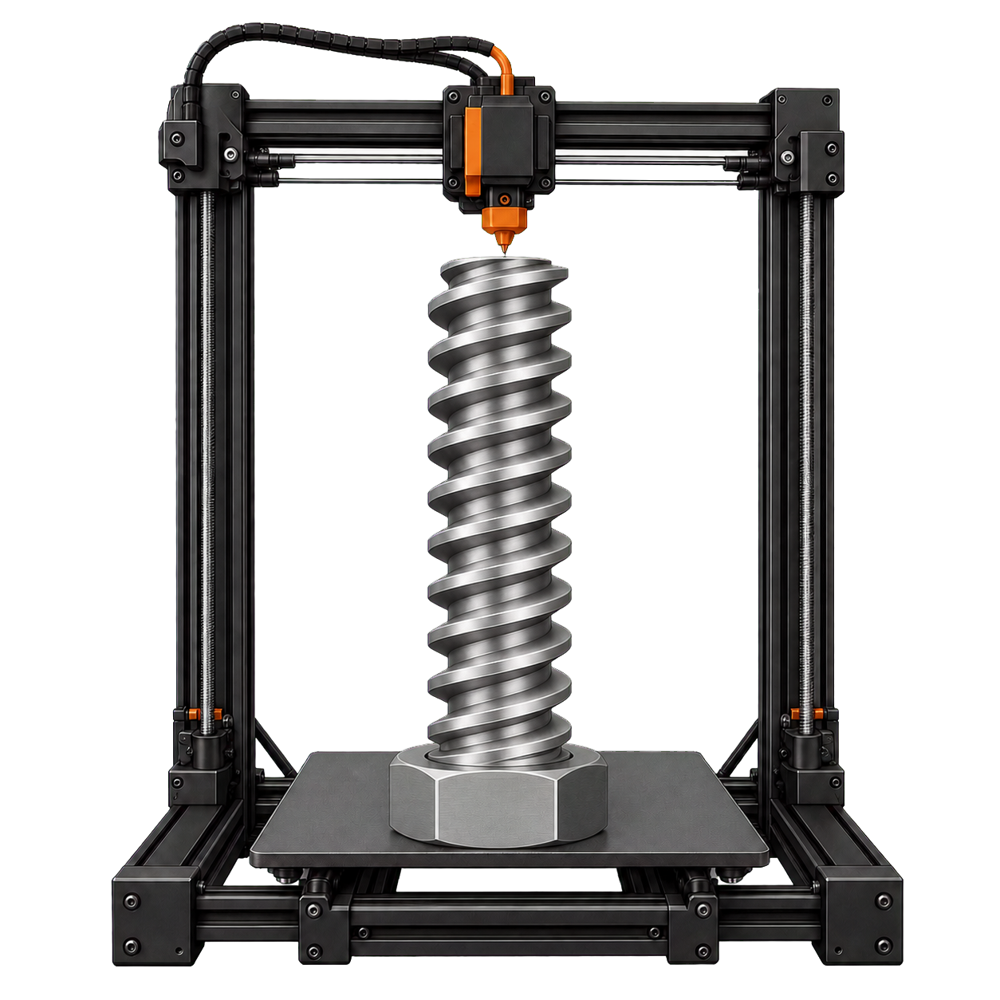
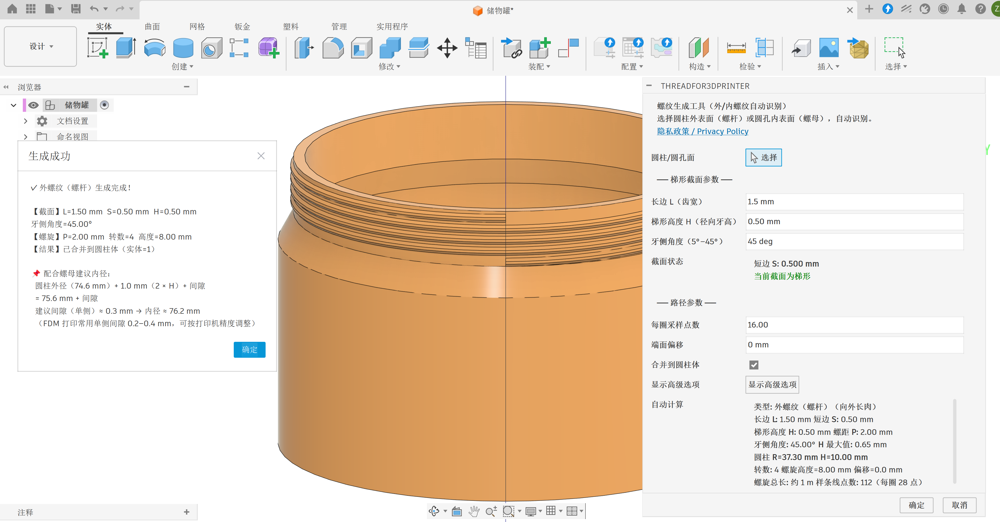
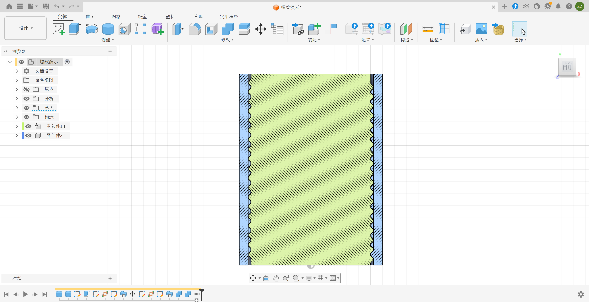
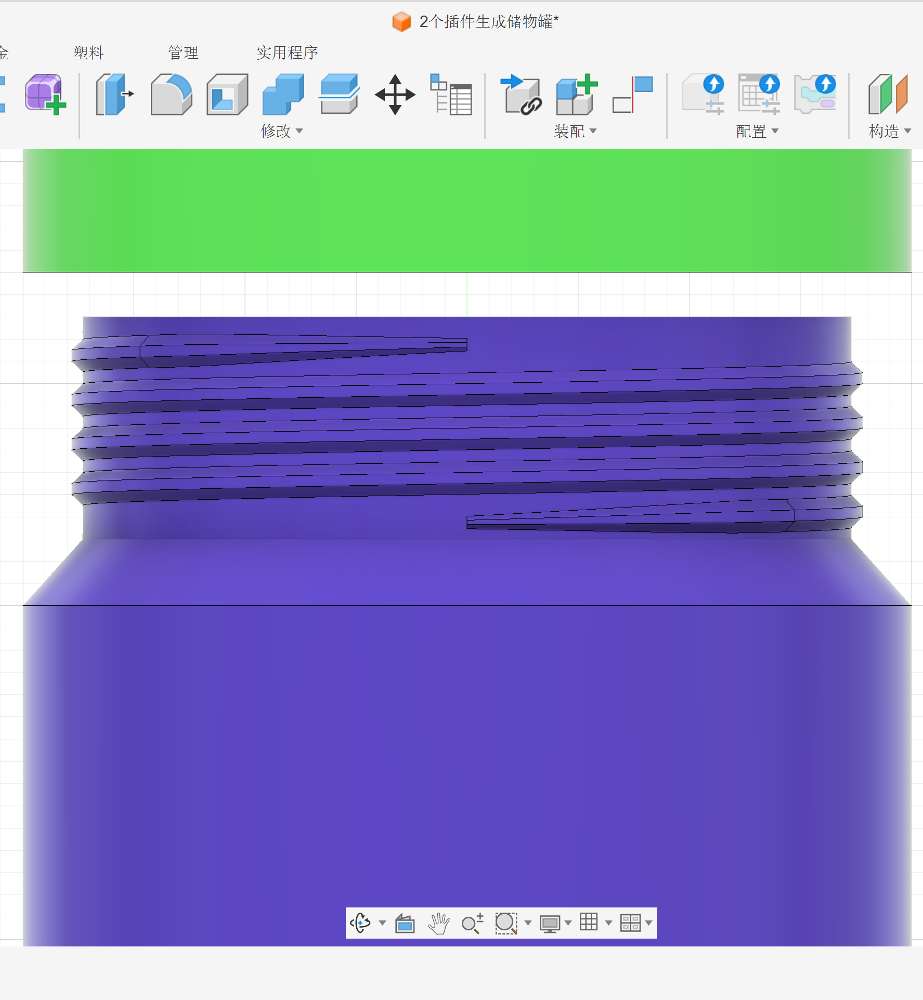

# Fusion 360 3D 打印螺纹生成器

[](https://github.com/HookyMaster/ThreadFor3DPrinter/releases/latest)
[](LICENSE)


[English README](README.md) · [下载 v3.2.0](https://github.com/HookyMaster/ThreadFor3DPrinter/releases/download/v3.2.0/ThreadFor3DPrinter-Test-v3.2.0.zip)



**ThreadFor3DPrinter** 是一个 Autodesk Fusion 附加模块，用于生成适合 3D 打印的粗牙梯形**外螺纹和内螺纹**。选择圆柱面后，工具会自动判断它属于螺杆外表面还是螺母/圆孔内表面。

## 主要功能

- 同时支持螺杆外螺纹和螺母/圆孔内螺纹。
- 使用适合 3D 打印的梯形牙型，实时显示由 L、S、H 计算出的梯形底角。
- 自动识别内、外圆柱面。
- 默认使用普通模式：输入牙底宽度、牙高和牙侧角，自动联动牙顶宽度与螺距。
- 点击“专家模式”后，可独立调整螺距、牙顶宽度、牙底宽度和牙高；风险参数只显示警告，不会禁用“确定”。
- 允许最小 `0.08 mm` 牙顶平宽，避免截面退化或自相交。
- 可选**螺纹收口**：螺纹入口/出口各生成 1/8 圈渐变（牙高+牙宽 10%↔100%），便于螺母/螺杆对位旋入，且两端更易打印；可在对话框中关闭。
- 显示估算的螺旋总长和样条线点数，并对高风险采样设置给出提示。
- 生成完成后给出配合螺母或螺杆的建议直径及打印间隙。
- 支持 Windows 和 macOS 上的 Autodesk Fusion。

## 效果展示

| 外螺纹 | 内螺纹 | 旋盖罐示例 |
| --- | --- | --- |
|  |  |  |

### 内外螺纹配合剖面



### 螺纹收口特写



螺纹入口/出口各 1/8 圈将梯形截面（牙高+牙宽同步）从 10% 渐变到全尺寸，两端形成尖锥形导入。配合件可直接滑入收口定位，无需反复找牙起始位置；牙型渐变的两端比垂直薄壁更易打印——FDM 切片下垂直薄尖几乎会消失。对话框里的"螺纹收口"复选框（默认勾选）控制该行为；取消勾选则生成完整牙高的普通螺纹。

## 安装所需文件

请将以下三个文件放在同一个文件夹中：

```text
ThreadFor3DPrinter/
├── ThreadFor3DPrinter.py
├── ThreadFor3DPrinter.manifest
└── icon-v4.png
```

清单文件已经将 `icon-v4.png` 设置为 Fusion“脚本和附加模块”窗口中的图标。

## 安装方法

### Windows

将完整的 `ThreadFor3DPrinter` 文件夹复制到：

```text
%APPDATA%\Autodesk\Autodesk Fusion 360\API\AddIns\
```

### macOS

将完整的 `ThreadFor3DPrinter` 文件夹复制到：

```text
~/Library/Application Support/Autodesk/Autodesk Fusion 360/API/AddIns/
```

也可以在 Fusion 中打开 **实用程序 > 附加模块 > 脚本和附加模块**，切换到 **附加模块** 页，点击绿色 **+**，然后选择 `ThreadFor3DPrinter` 文件夹。

## 启动附加模块

1. 打开 Fusion，进入 **设计** 工作区。
2. 打开 **实用程序 > 附加模块 > 脚本和附加模块**。
3. 切换到 **附加模块** 页。
4. 选择 **ThreadFor3DPrinter**，点击 **运行**。
5. 启动成功后，**实体 > 创建** 面板中会出现 **ThreadFor3DPrinter** 命令。

如果希望每次启动 Fusion 时自动加载，可在“脚本和附加模块”窗口中启用 **启动时运行**。

## 建模准备

- 生成外螺纹：先创建实体圆柱，再选择圆柱的外侧圆柱面。
- 生成内螺纹：先创建圆孔，再选择圆孔的内侧圆柱面。
- 目标必须是真正的 BRep 圆柱面；不支持圆锥面、网格面、分段近似面或任意曲面。
- 圆柱轴向长度需要能够容纳螺纹尺寸和端面偏移。

## 操作方法

1. 从 **实体 > 创建** 中运行 **ThreadFor3DPrinter**。
2. 点击 **圆柱/圆孔面**，然后选择且仅选择一个圆柱面。
3. 在“自动计算”区域确认识别结果：
   - **外螺纹（螺杆）**：梯形牙型向外生长。
   - **内螺纹（螺母）**：梯形牙型向内生长。
4. 设置螺纹参数：
   - **专家模式**：默认关闭。关闭时采用原来的 L/H/α 联动方法；开启后使用独立 P/S/L/H。
   - **螺距 P**：相邻牙型的轴向距离，默认 `4 mm`。
   - **牙顶宽度 S**：梯形牙顶的平面宽度，默认 `1 mm`，最小 `0.08 mm`。
   - **牙底宽度 L**：梯形牙根的平面宽度，默认 `3 mm`。
   - **梯形高度 H（牙高）**：螺纹牙型的径向高度/深度，默认 `1 mm`。
   - **梯形底角 α**：由 L、S、H 自动计算；大于 `45°` 时报告危险，但不禁止生成。
   - **每圈采样点数**：螺旋线的采样精度，默认 `16`，最小值为 `4`。对于大直径，工具会自动提高该值，使螺旋路径与圆柱面的偏差不超过牙高的四分之一；你输入的值作为下限使用。
   - **端面偏移**：从圆柱端面到螺旋线起点的距离，默认 `0 mm`。
   - **螺纹收口**：勾选（默认）后，螺纹入口/出口各生成 1/8 圈渐变收口（牙高+牙宽 10%↔100%），便于螺母/螺杆对位旋入，且两端更易打印；取消勾选则生成完整牙高的普通螺纹（旧版行为）。
   - **合并到圆柱体**：勾选（默认）后，螺纹体会通过布尔合并与所选圆柱体合并为单一实体；取消勾选则螺纹与圆柱体保持为两个独立实体。合并可消除放大时两实体之间的接缝。
   - **显示高级选项**：勾选后显示“路径偏差系数”输入框。
   - **路径偏差系数**（高级选项）：控制螺旋拟合样条偏离圆柱面的允许偏差，以牙高 H 的比例表示（允许偏差 = 系数 × H）。默认 `0.25`（即偏差不超过牙高的四分之一），推荐范围 `0.1–0.5`。系数越小，每圈采样点越多、牙侧面越光滑，但生成越慢；过大可能导致扫掠失败。鼠标悬浮在该输入框上可查看详细说明。
5. 普通模式下设置 L、H、α，并检查自动计算的 S 和 P。专家模式下直接设置 P、S、L、H；“截面状态”会报告底角、窄牙顶和相邻牙重叠等风险，但不会因为这些警告禁用“确定”。
6. 点击 **确定**。工具会创建螺旋路径、梯形截面，并扫掠生成螺纹实体。

## 参数约束

工具按以下公式计算：

```text
单侧牙面退让 A   = (L - S) / 2
牙侧角 α         = atan(H / A)
```

`P` 为螺距，`L` 为牙底宽度，`S` 为牙顶宽度（牙顶平宽），`H` 为径向牙高，`A` 为每侧牙面的轴向退让量。P、S、L、H 均可独立输入。底角大于 `45°` 时显示危险警告；`0.08 mm ≤ S < 0.20 mm` 时提示打印时降低层高并调整线宽；`S < 0.08 mm` 时显示更强烈的打印危险警告。这些警告不禁止生成。

专家模式建议条件（违反时显示警告，不禁止生成）：

- `L > S > 0`
- `H > 0`
- `α ≤ 45°`
- `S ≥ 0.20 mm`；若 `0.08 mm ≤ S < 0.20 mm`，打印时降低层高并调整线宽
- 生成内螺纹时，`H` 必须小于圆孔半径。

工具会在轴向预留大约一整圈的空间，因此实际生成圈数可能小于“圆柱长度 ÷ 螺距”的简单计算结果。

## 特殊案例：67 mm 相机滤镜螺纹

常见 67 mm 相机滤镜使用 `M67 × 0.75` 螺纹。由于必须精确保持 `0.75 mm` 螺距，建议开启**专家模式**，将 P、S、L、H 独立设置。

一组用于 FDM 试打印的起始参数为：

```text
螺距 P：       0.75 mm
牙顶宽度 S：   0.12 mm
牙底宽度 L：   0.58 mm
牙高 H：       0.40 mm
基体圆柱直径： 66.00 mm
目标牙顶外径： 66.80 mm
```

这组尺寸对应的插件底角约为 `60.1°`，会触发“底角大于 45°”危险警告；`0.12 mm` 牙顶也会触发降低层高、调整线宽的提示。专家模式不会因此禁止生成，但 Fusion 扫掠和实际打印均存在较高风险，应先打印 3–5 圈的短测试环。

理论剩余槽宽为 `P − L = 0.17 mm`。若配合件牙顶约为 `0.15 mm`，名义轴向余量仅约 `0.02 mm`，打印误差很容易消耗该余量，不能仅凭计算认定不会卡死。

完整尺寸推导、角度定义、内外螺纹设计和测试记录模板见：[如何设计 67 mm 滤镜螺纹](如何设计67mm滤镜螺纹.md)。

## 生成后的处理

扫掠结果会生成为一个**新实体**。请使用 Fusion 的 **组合** 命令进行后续处理：

- 外螺纹：使用 **合并**，将螺纹实体与圆柱连接。
- 内螺纹：同样使用 **合并**，将螺纹实体与零件主体连接。

生成完成后，对话框还会显示配合零件的建议直径。该数值仅作为起点，请使用短测试件验证建议的单侧 `0.2 mm` 打印间隙（常用范围 `0.2–0.4 mm`）。

对于需要互相配合的 3D 打印螺纹，应根据打印机、材料、层高和喷嘴尺寸预留间隙。建议先打印一段短测试件，再制作最终零件。

## 无界面自动化 API

`ThreadFor3DPrinter.py` 提供两个公共 Python 函数，无需打开或操作
Fusion 命令对话框即可生成螺纹。

### 直接传入圆柱面

```python
import ThreadFor3DPrinter as thread_tool

result = thread_tool.generate_thread(
    face=target_cylindrical_face,
    tooth_width_mm=1.5,
    tooth_height_mm=0.5,
    pitch_mm=2.0,
    crest_width_mm=0.5,
    end_offset_mm=1.0,
    samples_per_turn=16,
    join_to_target=True,
    feature_name='Lid_Internal_Thread',
    max_turns_per_sweep=4,
    flank_angle_degrees=30,
    deviation_ratio=0.25,
    enable_lead=True,
)
print(result)
```

### 使用 JSON 和实体令牌

```python
payload = {
    'face_token': target_cylindrical_face.entityToken,
    'tooth_width_mm': 1.5,
    'tooth_height_mm': 0.5,
    'pitch_mm': 2.0,
    'crest_width_mm': 0.5,
    'end_offset_mm': 1.0,
    'samples_per_turn': 16,
    'join_to_target': True,
    'feature_name': 'Lid_Internal_Thread',
    'max_turns_per_sweep': 4,
    'flank_angle_degrees': 30,
    'deviation_ratio': 0.25,
    'enable_lead': True,
}

result = thread_tool.generate_thread_from_json(payload)
```

`generate_thread_from_json` 可以接收 Python 字典或 JSON 对象字符串。
返回值是可直接序列化为 JSON 的字典，包含：

- 检测到的螺纹类型（`external` 或 `internal`）；
- 螺距、牙顶宽度、牙底宽度、牙高和反算的牙侧角；
- 圈数和实际生成的螺纹长度；
- 圆柱半径和高度；
- 采样数及端面偏移；
- 扫掠段数及每段最大圈数；
- 是否已与目标实体合并；
- Fusion 时间线组名称；
- 结果实体令牌。

### 自动化说明

- `face` 必须是真实的圆柱 BRep 面。
- 公共 API 的尺寸单位均为毫米。
- 未提供 `pitch_mm` 和 `crest_width_mm` 的旧调用方式继续采用原来的
  `5°–45°` 牙侧角及 `0.08 mm` 牙顶校验。
- 提供 `pitch_mm` 和 `crest_width_mm` 时，`tooth_width_mm` 表示独立牙底宽度；
  底角大于 `45°` 或牙顶小于 `0.20 mm` 只报告风险，不阻止生成。
- `samples_per_turn` 的最小有效值为 `4`。该值作为下限使用：对于大半径
  圆柱，工具会自动提高每圈采样数，使拟合螺旋线与圆柱面的偏差不超过
  牙高的四分之一，从而让扫掠始终贴合引导面，避免 `ASM_SWEEP_ILLEGAL_SURFACE`。
  每圈采样数的有效值上限为 `360`。若自适应后的每圈密度会使总采样点数
  超过 `20000`，工具会减少圈数而非降低采样密度，以保证保留的每一圈都有
  完整精度。
- `max_turns_per_sweep` 默认为 `4`。长螺纹采用分段扫掠，以避免
  Fusion 几何内核在长路径上失败；螺距联动公式保持不变。
- `deviation_ratio` 默认值为 `0.25`（即 `HELIX_DEVIATION_TOLERANCE_RATIO`），
  取值范围为 `(0, 1]`。它表示螺旋拟合样条允许偏离圆柱面的最大距离占牙高
  H 的比例（允许偏差 = `deviation_ratio × tooth_height_mm`）。值越小，每圈
  采样点越多、牙侧面越光滑，但生成越慢；值过大可能导致
  `ASM_SWEEP_ILLEGAL_SURFACE`。推荐范围 `0.1–0.5`。返回结果字典中的
  `deviation_ratio` 字段为实际生效值。
- `enable_lead` 默认为 `True`：在螺纹入口/出口各生成 1/8 圈渐变收口
  （牙高+牙宽 10%↔100%），更易旋入且两端更易打印；设为 `False` 则生成
  完整牙高的普通螺纹（旧版行为）。
- 每次生成只创建一个螺旋草图、一个截面构造平面和一个截面草图。
  后续扫掠段在各自路径起点独立绘制梯形截面，并始终保留圆柱导向面；
  相邻段在接缝处有少量体积重叠，保证布尔合并稳定。
- 每次成功生成产生的所有特征都会放入一个名为
  `<feature_name>_Generation` 的 Fusion 时间线组；当 Fusion 允许分组时才会
  创建。如果无法分组（例如对应的时间线区间内已存在分组），生成仍会成功，
  只是跳过时间线分组这一步。
- `join_to_target=False` 保持 GUI 的原有行为，生成独立螺纹实体。
- `join_to_target=True` 会将螺纹合并到选中的目标实体。
- `feature_name` 用作草图、构造平面、扫掠、实体和组合特征的名称前缀。

## 常见问题

- **“确定”按钮不可用：** 确认只选择了一个圆柱面；参数风险警告不会禁用按钮。
- **提示内螺纹牙高错误：** 减小 `H`，确保它小于圆孔半径。
- **参数风险警告：** 底角大于 `45°` 会报告危险；牙顶宽度在 `0.08–0.20 mm` 时请降低层高并调整线宽。警告不会禁用“确定”。
- **工具栏中没有命令：** 在“脚本和附加模块”中重新运行附加模块，或重启 Fusion。
- **图标没有更新：** 关闭并重新打开“脚本和附加模块”窗口，或重启 Fusion。
- **螺纹看起来有棱角：** 增加“每圈采样点数”。数值越高，几何量和计算时间越大；螺旋线总采样点数上限为 20000，超过后会减少圈数而非降低采样密度。
- **长螺纹、大直径时圈数比预期少：** 自适应后的每圈采样已达到 20000 点预算上限，为保证路径贴合圆柱而自动减少了圈数。请稍微降低“每圈采样点数”，或为螺纹提供更多可用长度。
- **扫掠失败（ASM_SWEEP_ILLEGAL_SURFACE）：** 通常是螺旋路径无法足够贴近圆柱面。工具已会根据半径自适应采样；若仍然失败，请稍微降低“每圈采样点数”，或缩短螺纹（减小高度或增大端面偏移）。

## 卸载

先在“脚本和附加模块”中停止附加模块，关闭 Fusion，然后从 AddIns 目录中删除 `ThreadFor3DPrinter` 文件夹。
