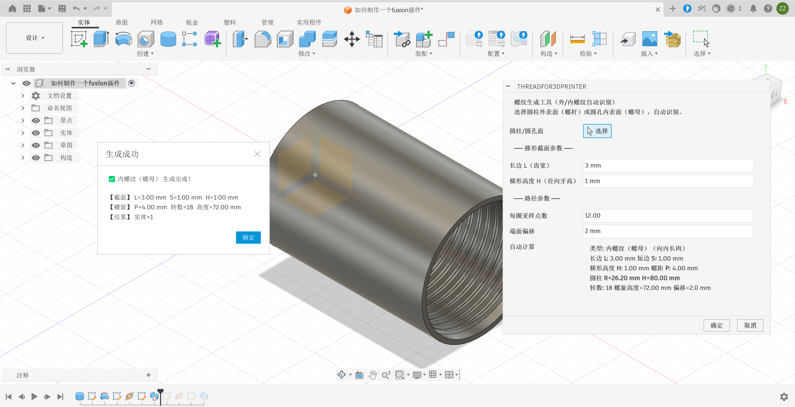

# Fusion 360 3D 打印螺纹生成器

[](https://github.com/HookyMaster/ThreadFor3DPrinter/releases/latest)
[](LICENSE)


[English README](README.md) · [下载最新版本](https://github.com/HookyMaster/ThreadFor3DPrinter/releases/latest/download/ThreadFor3DPrinter-v1.1.1.zip)


**ThreadFor3DPrinter** 是一个 Autodesk Fusion 附加模块，用于生成适合 3D 打印的粗牙梯形**外螺纹和内螺纹**。选择圆柱面后，工具会自动判断它属于螺杆外表面还是螺母/圆孔内表面。

## 主要功能

- 同时支持螺杆外螺纹和螺母/圆孔内螺纹。
- 使用适合 3D 打印的梯形牙型，两侧为固定 **45° 牙侧角**。
- 自动识别内、外圆柱面。
- 支持调整齿宽、牙高、采样精度和端面偏移。
- 显示估算的螺旋总长和样条线点数，并对高风险采样设置给出提示。
- 生成完成后给出配合螺母或螺杆的建议直径及打印间隙。
- 支持 Windows 和 macOS 上的 Autodesk Fusion。

## 效果展示

| 外螺纹 | 内螺纹 |
| --- | --- |
|  |  |

### 内外螺纹配合剖面


## 安装所需文件

请将以下三个文件放在同一个文件夹中：

```text
ThreadFor3DPrinter/
├── ThreadFor3DPrinter.py
├── ThreadFor3DPrinter.manifest
└── icon-v4.png
```

清单文件已经将 `icon-v4.png` 设置为 Fusion“脚本和附加模块”窗口中的图标。

## 安装方法

### Windows

将完整的 `ThreadFor3DPrinter` 文件夹复制到：

```text
%APPDATA%\Autodesk\Autodesk Fusion 360\API\AddIns\
```

### macOS

将完整的 `ThreadFor3DPrinter` 文件夹复制到：

```text
~/Library/Application Support/Autodesk/Autodesk Fusion 360/API/AddIns/
```

也可以在 Fusion 中打开 **实用程序 > 附加模块 > 脚本和附加模块**，切换到 **附加模块** 页，点击绿色 **+**，然后选择 `ThreadFor3DPrinter` 文件夹。

## 启动附加模块

1. 打开 Fusion，进入 **设计** 工作区。
2. 打开 **实用程序 > 附加模块 > 脚本和附加模块**。
3. 切换到 **附加模块** 页。
4. 选择 **ThreadFor3DPrinter**，点击 **运行**。
5. 启动成功后，**实体 > 创建** 面板中会出现 **ThreadFor3DPrinter** 命令。

如果希望每次启动 Fusion 时自动加载，可在“脚本和附加模块”窗口中启用 **启动时运行**。

## 建模准备

- 生成外螺纹：先创建实体圆柱，再选择圆柱的外侧圆柱面。
- 生成内螺纹：先创建圆孔，再选择圆孔的内侧圆柱面。
- 目标必须是真正的 BRep 圆柱面；不支持圆锥面、网格面、分段近似面或任意曲面。
- 圆柱轴向长度需要能够容纳螺纹尺寸和端面偏移。

## 操作方法

1. 从 **实体 > 创建** 中运行 **ThreadFor3DPrinter**。
2. 点击 **圆柱/圆孔面**，然后选择且仅选择一个圆柱面。
3. 在“自动计算”区域确认识别结果：
   - **外螺纹（螺杆）**：梯形牙型向外生长。
   - **内螺纹（螺母）**：梯形牙型向内生长。
4. 设置螺纹参数：
   - **长边 L（齿宽）**：梯形截面沿轴向的长边宽度，默认 `3 mm`。
   - **梯形高度 H（径向牙高）**：螺纹径向高度/深度，默认 `1 mm`。牙型每侧的轴向退让距离同样为 `H`，因此形成固定的 **45° 螺纹牙侧角**。
   - **每圈采样点数**：螺旋线的采样精度，默认 `16`，最小值为 `4`。
   - **端面偏移**：从圆柱端面到螺旋线起点的距离，默认 `0 mm`。
5. 检查工具自动计算的短边、螺距、圈数、螺旋高度和总长、样条线点数、圆柱尺寸及内外螺纹类型。
6. 点击 **确定**。工具会创建螺旋路径、梯形截面，并扫掠生成螺纹实体。

## 参数约束

工具按以下公式计算：

```text
短边 S = L - 2H
螺距 P = L + S = 2(L - H)
```

梯形螺纹的左右两侧牙面均为 **45°**。该角度由脚本固定，不能通过输入参数调整。这里的 45° 是指倾斜牙侧面与螺纹轴线之间的夹角；它与径向方向之间的夹角同样为 45°。

参数必须满足：

- `L > 0`
- `H > 0`
- `L - 2H > 0`
- 生成内螺纹时，`H` 必须小于圆孔半径。

工具会在轴向预留大约一整圈的空间，因此实际生成圈数可能小于“圆柱长度 ÷ 螺距”的简单计算结果。

## 生成后的处理

扫掠结果会生成为一个**新实体**。请使用 Fusion 的 **组合** 命令进行后续处理：

- 外螺纹：使用 **合并**，将螺纹实体与圆柱连接。
- 内螺纹：同样使用 **合并**，将螺纹实体与零件主体连接。

生成完成后，对话框还会显示配合零件的建议直径。该数值仅作为起点，请使用短测试件验证建议的 `0.3–0.5 mm` 打印间隙。

对于需要互相配合的 3D 打印螺纹，应根据打印机、材料、层高和喷嘴尺寸预留间隙。建议先打印一段短测试件，再制作最终零件。

## 常见问题

- **“确定”按钮不可用：** 确认只选择了一个圆柱面，并检查参数是否满足上述约束。
- **提示内螺纹牙高错误：** 减小 `H`，确保它小于圆孔半径。
- **工具栏中没有命令：** 在“脚本和附加模块”中重新运行附加模块，或重启 Fusion。
- **图标没有更新：** 关闭并重新打开“脚本和附加模块”窗口，或重启 Fusion。
- **螺纹看起来有棱角：** 增加“每圈采样点数”。数值越高，几何量和计算时间越大；脚本将螺旋线总采样数限制为 400。
- **扫掠失败：** 尝试使用更简单的圆柱实体、减小螺纹尺寸、增加轴向可用长度，或增大端面偏移。

## 卸载

先在“脚本和附加模块”中停止附加模块，关闭 Fusion，然后从 AddIns 目录中删除 `ThreadFor3DPrinter` 文件夹。
